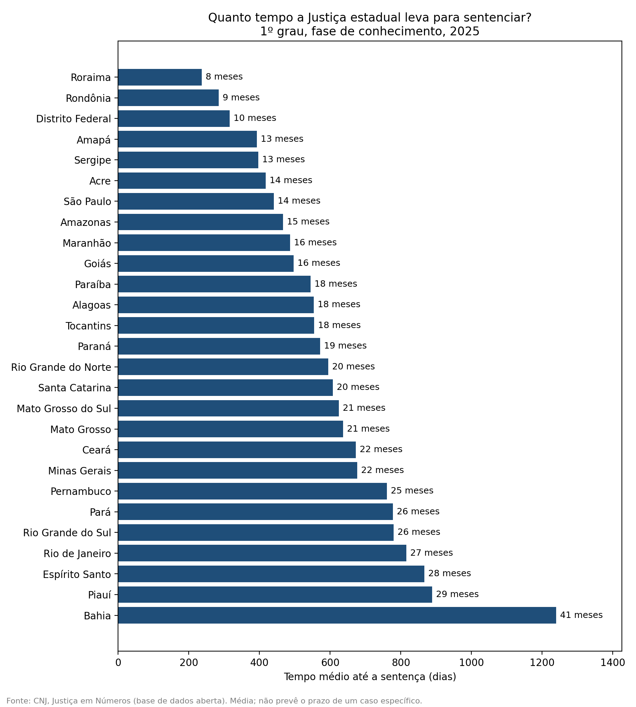

# Relógio da Justiça

Quanto tempo a Justiça estadual leva para sentenciar um processo em cada estado?

**Painel interativo:** https://datastudio.google.com/reporting/d4fd1bea-fd04-4483-a20f-b48f44b70b2f

## Principais achados

- Em 2025, o tempo médio até a sentença (1º grau, fase de conhecimento) variou de cerca de **8 meses em Roraima** a cerca de **41 meses na Bahia**, mais de 5 vezes de diferença.
- São Paulo, que mais sentenciou no ano (2,2 milhões de sentenças no indicador), ficou em 7º lugar, com cerca de 14,5 meses.
- Entre 2020 e 2025, a média dos 27 TJs, ponderada pelo número de sentenças, oscilou pouco: de cerca de 669 para 628 dias. Há uma quebra de série entre 2019 e 2020, provavelmente ligada à mudança do cálculo dos indicadores para o DataJud pelo CNJ; por isso não comparamos os dois períodos.

## Dados e método

- **Fonte:** CNJ, Justiça em Números, base de dados aberta (arquivo de junho de 2026).
- **Indicador:** `TpSentC1`, tempo médio até a sentença, 1º grau, fase de conhecimento. Unidade: dias.
- **Escopo:** 27 Tribunais de Justiça (26 estados e o DF), de 2016 a 2025. 2015 foi excluído por cobertura incompleta.
- **Validação:** a média ponderada de 2018 (871 dias, cerca de 2 anos e 4 meses) é coerente com o valor publicado pelo CNJ para as varas estaduais naquele ano.

## Limitações

- É uma média: processos muito longos elevam o valor. Não prevê o prazo de um caso específico.
- Diferenças entre estados podem refletir o tipo de demanda, a estrutura e a forma de registro dos dados, e não apenas eficiência.
- Os dados dependem do que cada tribunal informa ao CNJ.

## Arquivos

- `relogio_da_justica.csv`: base limpa usada no painel.
- `grafico_2025_v2.png`: ranking de 2025.

## Autoria

Patrícia Andressa da Silva Falchi · https://www.linkedin.com/in/patricia-falchi/

Dados abertos do CNJ. Projeto independente, sem vínculo institucional.
